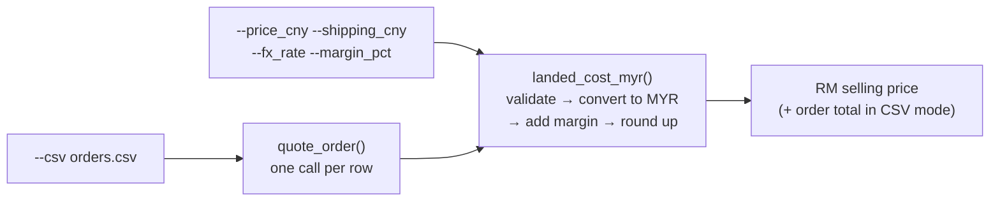

# Project name : tapau-quote
CLI that calculates the selling price in MYR from a CNY price, shipping, FX rate and target margin.

## Usage

Quote one item:
python3 quote.py --price_cny 100 --shipping_cny 10 --fx_rate 0.65 --margin_pct 0.2

Quote a whole order from a CSV:
python3 quote.py --csv orders.csv

Run the tests:
uv run pytest -v

## Why
I personally run a dropshipping business. And this project helps me to find out what price I should be selling at corresponding to my pleased margin percentage.

## How it works

- **One formula, two entry points:** single item via flags, or a whole order via `--csv`. Both go through `landed_cost_myr()`.
- **Formula:** `ceil((price_cny + shipping_cny) × fx_rate / (1 − margin_pct))`. Margin is a share of the selling price, not a markup on cost, so RM71.50 cost at 0.2 margin gives RM90, not RM86.
- **Always rounds up** to the next whole number, so the real margin never drops below the target.
- **Input checks:** rejects margin outside 0–1 (1 not allowed), fx_rate ≤ 0, negative price or shipping, and a price of 0. Shipping of 0 is fine.
- **CSV mode:** each row has its own fx_rate and margin. It prints every item plus an order total, and one bad row stops the whole order.

## Decisions
- Chose CLI instead of having an entire GUI because it's a simple "calculator" for my own use to fasten my calculation for the selling price

## Run it
git clone https://github.com/WenKhong/tapau-quote.git && cd tapau-quote
python3 quote.py --price_cny 100 --shipping_cny 10 --fx_rate 0.65 --margin_pct 0.2
python3 quote.py --csv orders.csv

No install needed; it only uses the Python standard library (Python 3.13 or newer).

## Tests
`uv run pytest` · CI badge

## What AI did / what I did
I wrote the code initially and used AI to help me verify and know where else to improve at.